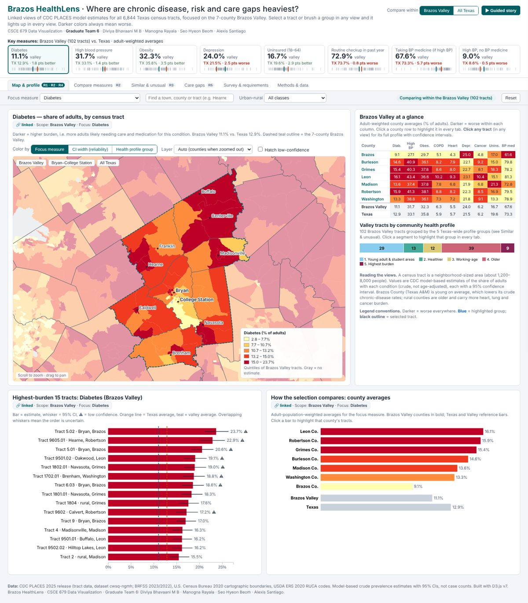
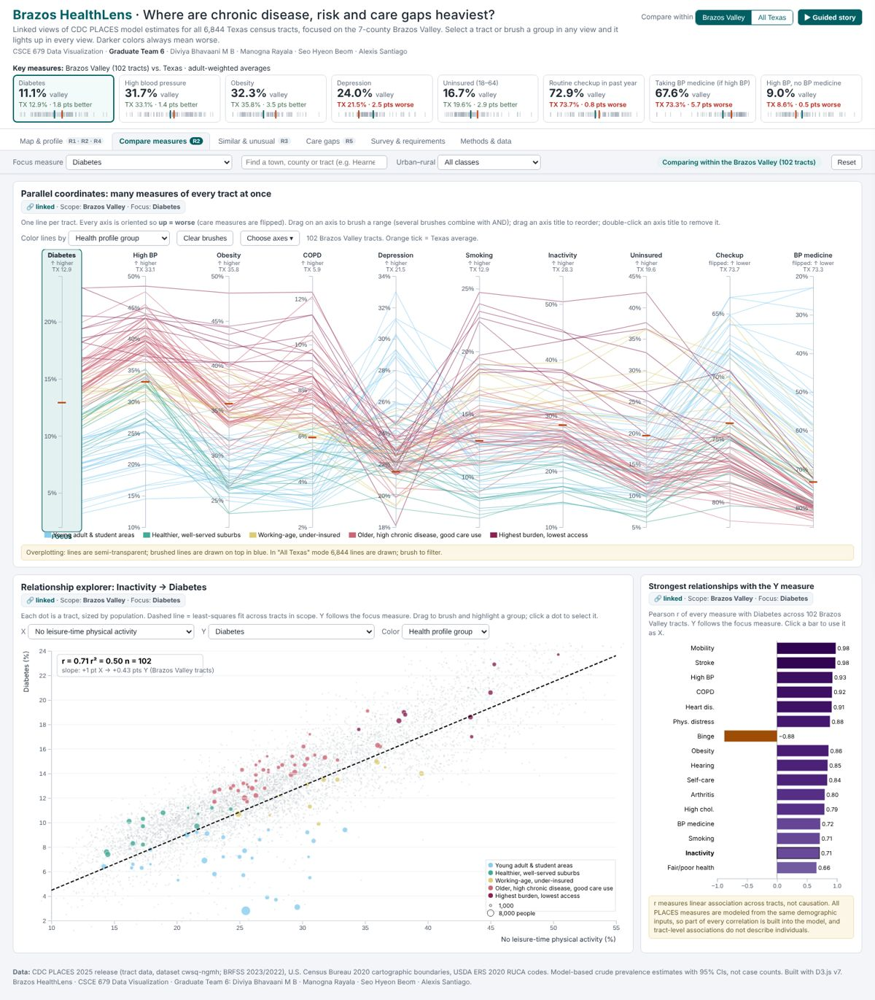
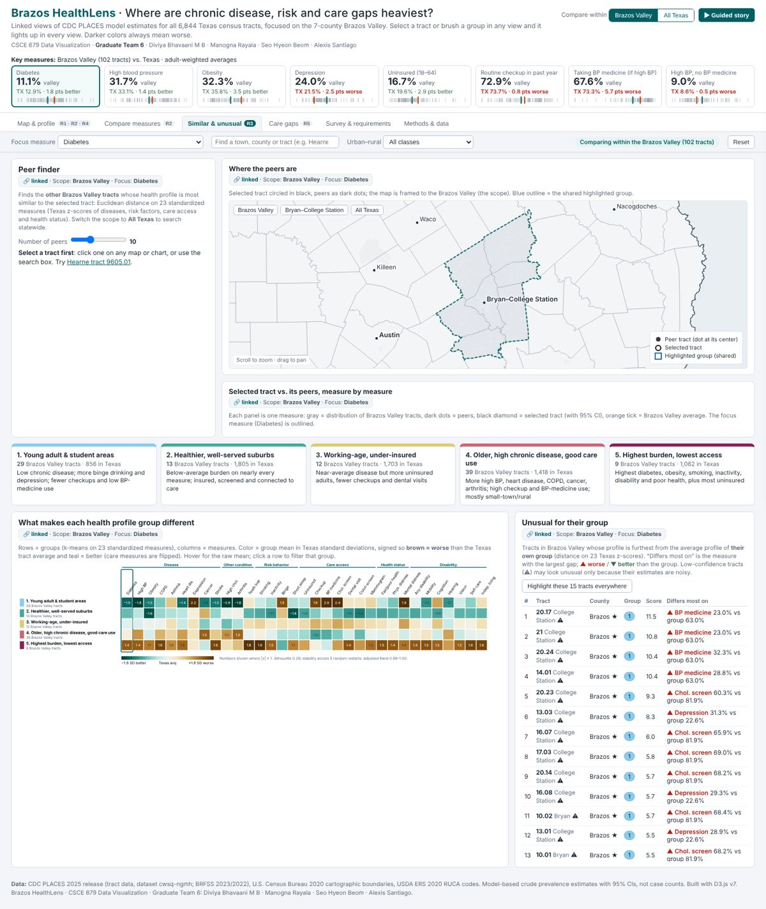
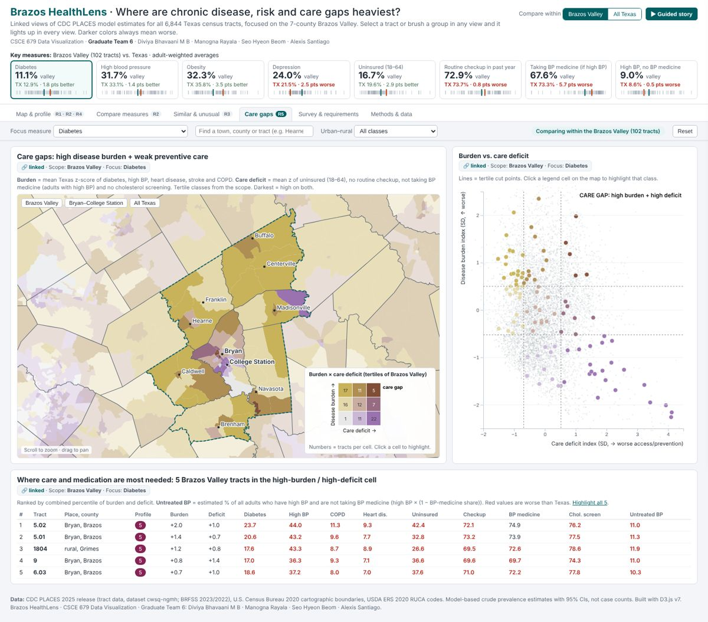
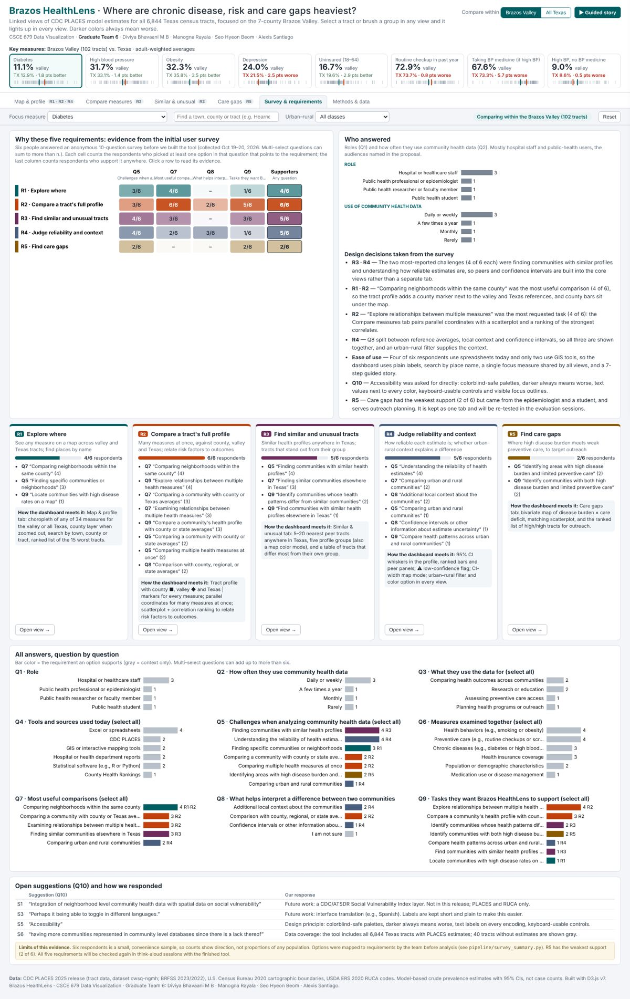

# Brazos HealthLens

**A linked visual analytics dashboard for chronic disease, risk factors and care gaps in the Brazos Valley, Texas.**

CSCE 679 Data Visualization · Texas A&M University · Fall 2026 · **Graduate Team 6**

Design, data processing, implementation, evaluation is done by the below team members : 
1. Diviya Bhavaani Meenakkshi Sundar Banumathy
2. Manogna Rayala 
3. Seo Hyeon Beom 
4. Alexis Santiago 



---

## What it does

Brazos HealthLens maps CDC PLACES estimates for all **6,844 Texas census tracts** with a focus on the
**7-county Brazos Valley** (Brazos, Burleson, Grimes, Leon, Madison, Robertson, Washington; 102 tracts).
Every view is linked: pick a tract, brush a range or choose a group in one view and it lights up in all the
others. Darker colors always mean worse, and every estimate shows its 95% confidence interval.

**Open `index.html` in a browser. No install, server or internet connection is needed.**
A **▶ Guided story** button walks through seven findings, one or two per requirement.

## Requirements and how the survey supports them

We surveyed six intended users (3 hospital or healthcare staff, 1 epidemiologist, 1 faculty researcher,
1 public-health student) before building. Their answers produced the five requirements in our proposal. The
dashboard implements these five and nothing else. The **Survey & requirements** tab shows every answer.

| ID | Requirement | Survey evidence (n = 6) | Where in the dashboard |
|---|---|---|---|
| **R1** | **Explore where**: see any measure on a map; find places by name | 4/6 · Q7 “comparing neighborhoods within the same county” (4), Q5 “finding specific communities” (3) | Map & profile: choropleth, county layer, search, ranked tracts |
| **R2** | **Compare a tract's full profile** with county, valley and Texas; relate risk factors to outcomes | 6/6 · Q9 “explore relationships between multiple measures” (4), Q7 “compare with county or Texas averages” (3) | Tract profile (county ■, valley ◆, Texas markers); Compare measures: parallel coordinates and relationship explorer |
| **R3** | **Find similar and unusual tracts** | 5/6 · Q5 “finding communities with similar profiles” (4), Q7 “similar communities elsewhere in Texas” (3) | Similar & unusual: peer finder, profile groups, “unusual for their group”; map colored by group |
| **R4** | **Judge reliability and urban–rural context** | 5/6 · Q5 “understanding the reliability of estimates” (4), Q8 local context (2) and CIs (1) | CI whiskers and ⚠ flags in all views; CI-width map mode; urban–rural filter and color option |
| **R5** | **Find care gaps**: high disease burden with weak preventive care | 2/6 · Q5 and Q9 (2 each; epidemiologist and student) | Care gaps: bivariate map, scatterplot, ranked outreach list |

Ease of use is a design principle across all views (Q4: four of six respondents work in spreadsheets, only two
use GIS; Q10 asked for accessibility). R5 has the weakest support and will be re-tested in our think-aloud evaluation.

## The six tabs

| Tab | Views (all D3.js) |
|---|---|
| **Map & profile** (R1 · R2 · R4) | Canvas choropleth of 6,884 tracts with zoom, three color modes (focus measure / CI width / profile group), low-confidence hatching; tract profile with CIs; 15 highest-burden tracts with CI whiskers; county averages |
| **Compare measures** (R2) | Parallel coordinates with brushable, reorderable axes; scatterplot with least-squares fit and live r; ranking of the measures most correlated with the Y measure |
| **Similar & unusual** (R3) | Peer finder (5–20 nearest tracts, valley or statewide) with peer map and per-measure panels; five profile-group cards; group heatmap; tracts most unlike their own group |
| **Care gaps** (R5) | 3×3 bivariate map (burden × care deficit); matching scatterplot; ranked list of high/high tracts |
| **Survey & requirements** | Evidence matrix R1–R5 × survey question; respondents; design decisions; one card per requirement; every question's answers; Q10 suggestions and our responses |
| **Methods & data** | Sources, methods, caveats, palettes |

Shared controls: comparison scope (Brazos Valley / all Texas), focus measure (34 measures), search, urban–rural
filter, the selected tract chip, the highlighted group chip and Reset. KPI cards at the top follow the scope and
the current highlight.

| | |
|---|---|
|  |  |
|  |  |

## Run it

```bash
git clone https://github.com/<your-account>/brazos-healthlens.git
cd brazos-healthlens
# then double-click index.html, or serve the folder:
python -m http.server 8000      # open http://localhost:8000
```

The data are loaded as plain `<script>` files (`window.HL_DATA = …`), so the page also works straight from
`file://` without a server.

### Publish on GitHub Pages

The workflow in `.github/workflows/deploy.yml` publishes the site on every push to `main`.
In the repository go to **Settings → Pages → Build and deployment → Source: GitHub Actions**, push, and the site
appears at `https://diviyabhavaani-mb.github.io/brazos-healthlens/`.

## Rebuild the data (optional)

The repository ships with built data in `data/`, so this is only needed to refresh it.

```bash
pip install -r pipeline/requirements.txt
cd pipeline
python download.py          # CDC PLACES (Texas), Census 2020 tract and place boundaries, USDA RUCA 2020 -> pipeline/raw/
python build_topology.py    # -> data/tracts_topo.js and pipeline/work/tract_geo.csv
python build_data.py        # -> data/healthlens_data.js
python survey_summary.py    # -> data/survey_summary.js (from survey/initial_user_survey.csv)
```

Or `make data` from the repository root. If the USDA RUCA link has moved, download the 2020 tract RUCA file
from the ERS website and save it as `pipeline/raw/ruca2020_tracts.xlsx` (see `pipeline/config.py`).
Profile-group names live in `pipeline/config.py`; check them against the group heatmap after a rebuild.

### Tests

```bash
python tests/test_pipeline.py   # offline: rebuilds raw inputs from data/, runs the pipeline, compares the output
python tests/smoke_test.py      # headless Chromium: every tab, every story step, linking; fails on console errors
```

## Repository structure

```
brazos-healthlens/
├── index.html                 # the dashboard
├── css/style.css
├── js/
│   ├── core.js                # data decoding, palettes, shared state store, tooltip, search, KPIs, tabs
│   ├── views.js               # geometry, MapView (canvas choropleth), ScatterView (canvas + SVG + brush)
│   ├── tab_map.js             # R1 R2 R4: map, tract profile, ranked tracts, county bars
│   ├── tab_compare.js         # R2: parallel coordinates, relationship explorer
│   ├── tab_similar.js         # R3: peers, profile groups, unusual-for-group table
│   ├── tab_gaps.js            # R5: bivariate care-gap map, scatter, list
│   ├── tab_survey.js          # survey evidence for R1–R5
│   ├── tab_methods.js         # methods text and footer
│   ├── story.js               # 7-step guided story
│   └── main.js                # start-up
├── data/
│   ├── healthlens_data.js     # tract estimates, CIs, groups, peers, aggregates (built by build_data.py)
│   ├── tracts_topo.js         # TopoJSON tracts + counties (built by build_topology.py)
│   └── survey_summary.js      # survey summary (built by survey_summary.py)
├── vendor/                    # D3.js v7.9.0 and topojson-client 3.1.0 (ISC license)
├── pipeline/                  # Python data pipeline (config, download, build_topology, build_data, survey_summary)
├── survey/initial_user_survey.csv
├── tests/                     # test_pipeline.py, smoke_test.py
├── docs/                      # proposal PDF, screenshots
└── .github/workflows/deploy.yml
```

## Data sources

- Centers for Disease Control and Prevention. **PLACES: Local Data for Better Health, Census Tract Data, 2025 release**
  (BRFSS 2023; five measures 2022). https://data.cdc.gov/resource/cwsq-ngmh
- U.S. Census Bureau. **2020 Cartographic Boundary Files**: `cb_2020_48_tract_500k`, `cb_2020_48_place_500k`.
- USDA Economic Research Service. **2020 Rural-Urban Commuting Area (RUCA) Codes**, census tracts.
- Team 6. **Initial user survey** (6 anonymous responses, October 2026), `survey/initial_user_survey.csv`.

**Caveats.** PLACES values are model-based, crude (not age-adjusted) prevalence estimates, not case counts.
Tract-level patterns do not describe individuals. Older rural tracts look worse on crude rates; the young,
student-heavy tracts in College Station look better on chronic disease but worse on checkups and BP medicine.

## Methods in brief

- **Color**: 5-class quantiles of the chosen scope (ColorBrewer YlOrRd; reversed for care measures).
- **Reliability (R4)**: CI width; ⚠ low confidence = CI among the widest 10% of Texas tracts for that measure.
- **Profile groups and peers (R3)**: 23 core measures z-scored across Texas (signed + = worse) → PCA (3 components,
  90% of variance) → k-means, k = 5 (best silhouette for k = 4–8, stable across restarts). Peers = 20 nearest tracts
  in Euclidean distance on the z-scores. Unusual score = distance from the tract to its group's mean profile.
- **Care gap (R5)**: burden = mean z of diabetes, high BP, heart disease, stroke, COPD; deficit = mean z of uninsured,
  no checkup, not taking BP medicine, no cholesterol screening; tertiles crossed in a 3×3 bivariate palette.

## Acknowledgements and AI use

Built with [D3.js](https://d3js.org) v7 and topojson-client (both ISC license). We used AI assistants
(Claude) to help draft code, documentation and the survey summary script; the team reviewed, tested and is
responsible for all of it.

## License

Code: MIT (see `LICENSE`). Data are U.S. federal public-domain sources; survey responses are anonymous.
